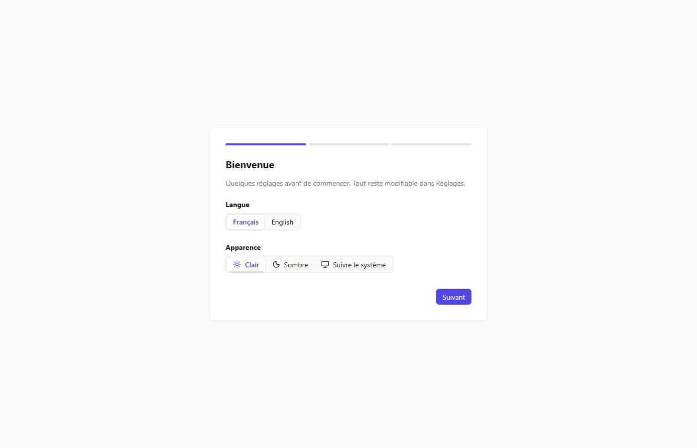
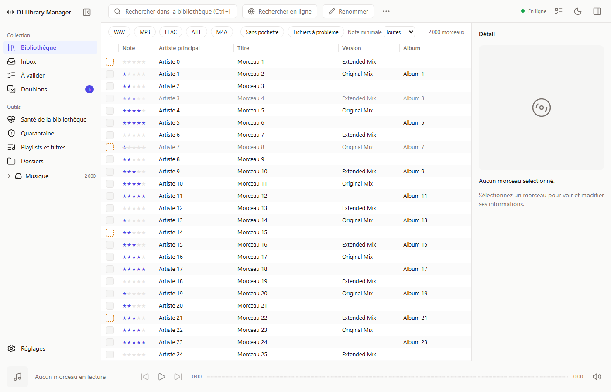
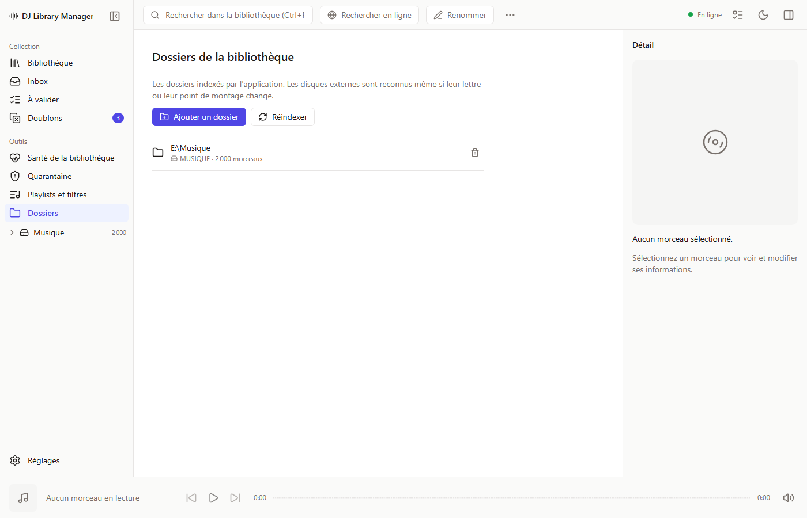
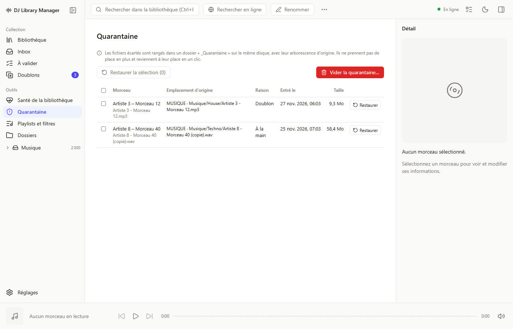
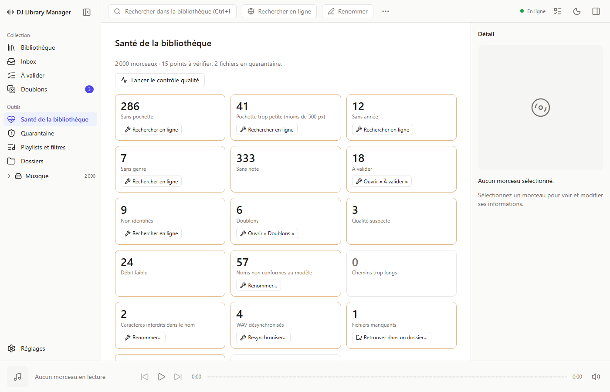
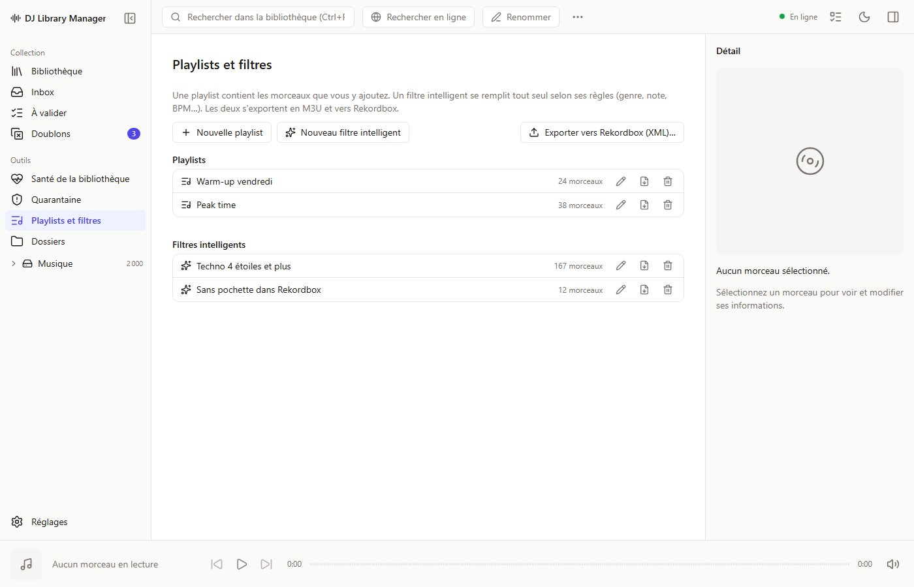

# Guide utilisateur

Ce guide explique chaque fonction pas à pas. Les captures montrent l'application avec des morceaux de démonstration.

**Sommaire :** [Installer](#installer-lapplication) · [Premier lancement](#premier-lancement) · [La fenêtre](#la-fenêtre) · [Ajouter votre musique](#ajouter-votre-musique) · [Le tableau](#le-tableau) · [Modifier les informations](#modifier-les-informations) · [Annuler](#annuler) · [Renommer](#renommer-les-fichiers) · [Nettoyer](#nettoyer-les-tags) · [Écouter](#écouter) · [Dossiers](#dossiers) · [Recherche en ligne](#recherche-en-ligne) · [Inbox](#inbox-dossier-darrivée) · [Doublons](#doublons) · [Quarantaine](#quarantaine) · [Santé de la bibliothèque](#santé-de-la-bibliothèque) · [Playlists et filtres](#playlists-et-filtres-intelligents) · [Rekordbox](#rekordbox) · [WAV et AIFF](#convertir-des-wav-en-aiff) · [Mises à jour](#mises-à-jour) · [Réglages](#réglages)

> **Avant tout essai :** travaillez sur une **copie** de quelques dizaines de morceaux, jamais sur votre vraie bibliothèque, tant que la phase n'est pas validée.

## Installer l'application

Voir le [README](../README.md) : téléchargement, installation et ouverture malgré l'alerte de sécurité.

## Premier lancement

Trois écrans :
1. **Langue et thème.**
2. **Vos dossiers** : choisissez le dossier de votre musique (branchez d'abord votre disque externe). Le dossier d'arrivée (Inbox) est facultatif.
3. **Recherche en ligne et Rekordbox** : explications et conseils.

Tout reste modifiable ensuite.

## La fenêtre

| Zone | Où | À quoi elle sert |
| --- | --- | --- |
| Barre latérale | à gauche | les écrans, et l'arborescence de vos dossiers sous « Dossiers ». Le bouton en haut la replie. |
| Barre du haut | en haut | rechercher (Ctrl+F), renommer (Ctrl+R), « Plus d'actions » (…), voir les tâches en cours, thème clair/sombre. |
| Centre | au milieu | le tableau de vos morceaux. |
| Panneau de détail | à droite | les informations du ou des morceaux sélectionnés, modifiables. **Ctrl+I** le masque ou l'affiche. |
| Lecteur | en bas | écouter, avec la forme d'onde cliquable. |

Sur Mac, **Cmd** remplace **Ctrl**.

Le thème sombre (bouton lune en haut à droite, ou Réglages › Apparence) :

## Ajouter votre musique

- Bibliothèque vide : bouton **Ajouter un dossier**. Ou glissez un dossier depuis l'Explorateur / le Finder sur la fenêtre.
- L'indexation se fait en tâche de fond : vous pouvez travailler pendant ce temps. Le bouton des tâches (en haut à droite) montre la progression et permet d'annuler.
- Ensuite, l'application calcule une « empreinte » de chaque fichier (elle sert aux doublons) ; c'est plus long et cela ne gêne rien.
- Les fichiers ajoutés, supprimés ou renommés en dehors de l'application sont repérés tout seuls.

## Disque externe

- Votre disque est reconnu même si sa lettre change (E: devient F:) ou si son point de montage change sur Mac.
- Disque débranché : un bandeau « Disque … déconnecté » s'affiche, les morceaux restent visibles en grisé et ne sont plus modifiables. Rebranchez-le : tout revient seul.
- Pour un disque utilisé sur Windows et sur Mac, le format **exFAT** est recommandé.

## Le tableau

- **Rechercher** : tapez dans la barre du haut (titre, artistes, album, genre, nom de fichier ; les accents sont ignorés).
- **Filtres rapides** au-dessus du tableau : format, sans pochette, fichiers à problème, note minimale. Un dossier choisi dans l'arborescence filtre aussi le tableau (puce « Dossier : … », cliquez dessus pour l'enlever).
- **Trier** : menu **Trier par** au-dessus du tableau (par exemple **Note : ★★★★★ d'abord**, puis par artiste et titre à note égale), ou cliquez sur un en-tête (une deuxième fois pour inverser ; la colonne **Note** met les mieux notés en premier dès le premier clic). Maj + clic ajoute une colonne de tri.
- **Colonnes** : clic droit sur les en-têtes pour en afficher ou masquer ; glissez un en-tête pour changer l'ordre ; tirez son bord droit pour la largeur. Tout est retenu.
- **Sélection** : clic, Ctrl + clic (ajouter), Maj + clic (plage), Ctrl+A (tout), flèches du clavier.
- Badges de la colonne État : hors ligne, manquant, illisible (le message exact s'affiche dans le panneau de détail ; un fichier illisible est relu à chaque indexation, donc au démarrage ou avec **Dossiers › Réindexer**), cadenas, **RB** (le morceau est dans Rekordbox ; **RB ↻** : ses tags ont changé, à recharger dans Rekordbox), WAV, tags désaccordés.

## Modifier les informations

Sélectionnez un ou plusieurs morceaux, puis modifiez dans le panneau de détail :
- Un champ se valide avec **Entrée** ou en le quittant ; **Échap** annule. **F2** place le curseur dans le titre.
- **Plusieurs morceaux** : un champ aux valeurs différentes affiche « Valeurs multiples » et n'est changé que si vous y touchez.
- **Artistes** : chaque artiste est une étiquette. L'étoile marque l'artiste principal (cliquez sur l'étoile d'un autre pour le mettre en premier). Glissez les étiquettes pour changer l'ordre. × pour retirer, champ « Ajouter un artiste… » puis Entrée.
- **Note** : cliquez sur les étoiles, ou tapez **0 à 5** au clavier quand le tableau a le focus.
- **Tonalité** : tapez-la comme vous voulez (Am, A minor, 8A…), elle est reconnue. Affichage et écriture en Camelot par défaut (Réglages).
- **Cadenas** : tout champ modifié à la main est verrouillé. Aucune automatisation (nettoyage, recherche en ligne de la phase 2) ne le modifiera. Cliquez sur le cadenas pour déverrouiller.
- **Pochette** : survolez la pochette du panneau → « Choisir une image… », « Coller » (ou **Ctrl+V**), « Retirer ». Vous pouvez aussi glisser une image depuis l'Explorateur sur la fenêtre. L'image est mise au carré si elle l'est presque, réduite à 1000 pixels et enregistrée en JPEG.
- **Plus d'actions** (…) : échanger artiste et titre, copier les tags d'un morceau puis les coller sur d'autres.

Chaque modification affiche une notification avec **Annuler**.

### Ce que l'application garantit à chaque écriture
Le son n'est jamais modifié. L'application écrit dans une copie, relit cette copie (tags et son), puis remplace l'original. Au moindre problème, l'original reste intact et un message explique pourquoi. Les données des autres logiciels (Serato, Rekordbox, Beatport, commentaires…) sont conservées.

### Fichiers WAV et Rekordbox
Les WAV reçoivent deux blocs de tags identiques (RIFF INFO, lu par Rekordbox, et ID3). Rekordbox n'affiche que titre, artiste, album, genre et commentaire d'un WAV, et **pas la pochette**.

## Annuler

- **Ctrl+Z** annule la dernière action, **Ctrl+Maj+Z** la rétablit. Cela marche aussi après avoir fermé et rouvert l'application.
- Une action sur plusieurs morceaux s'annule en une fois.

## Renommer les fichiers

1. Sélectionnez les morceaux, puis **Renommer** (ou Ctrl+R).
2. Le modèle par défaut est `{artiste_principal} - {titre}[ ({version})]` : par exemple « Artiste A - Titre (Extended Mix).wav ». Cliquez sur une variable pour l'insérer. Ce qui est entre crochets disparaît si le champ est vide.
3. L'aperçu montre chaque nom avant/après. Les problèmes sont signalés : nom déjà pris, nom interdit par Windows, champ vide, chemin trop long pour Rekordbox sur Mac.
4. Choisissez quoi faire si deux fichiers visent le même nom, puis **Renommer N fichiers**. **Aucun fichier n'est jamais écrasé.**
5. « Enregistrer ce modèle sous un nom » pour le retrouver plus tard.

Le panneau de détail montre aussi le nom que donnerait le modèle (« Nom selon le modèle »).

> Un morceau déjà importé dans Rekordbox et renommé ici y apparaîtra comme manquant. Si vous avez importé votre collection Rekordbox (voir [Rekordbox](#rekordbox)), l'aperçu l'annonce en clair avant de renommer, et le journal des chemins vous aide à relocaliser les fichiers.

## Nettoyer les tags

**Plus d'actions › Nettoyer les tags…** : cochez les règles (mentions parasites, numéros de piste, « _ », « feat. » vers les artistes, version séparée du titre, casse des versions…) et ajoutez vos propres règles rechercher / remplacer. L'aperçu montre chaque changement avant d'appliquer. Les champs verrouillés ne sont jamais touchés.

## Tags depuis le nom de fichier

**Plus d'actions › Tags depuis le nom de fichier…** : pour les fichiers sans tags. Choisissez la forme des noms (`{artistes} - {titre}`, `{piste}. {artistes} - {titre}`…) ou écrivez la vôtre. Par défaut seuls les champs vides sont remplis.

## Écouter

- Double-clic ou **Entrée** sur un morceau pour le lancer. **Espace** : lecture / pause.
- Cliquez sur la **forme d'onde** pour aller à cet endroit. Flèches gauche/droite : reculer / avancer de 10 secondes. Maj + flèches : morceau précédent / suivant (dans l'ordre du tableau).
- La lecture continue même si vous modifiez le morceau en cours.
- Trois boutons à droite de lecture / pause (allumés quand ils sont actifs) :
  - **Aléatoire** : le morceau suivant est tiré au hasard dans le tableau affiché (sans repasser deux fois le même) ; « précédent » revient au morceau joué avant.
  - **Répétition** : un clic = toute la liste (après le dernier, on repart du premier), deux clics = **ce morceau en boucle**, trois clics = désactivée.
  - **À la suite** : à la fin d'un morceau, le suivant démarre tout seul. Désactivé, la lecture s'arrête à la fin du morceau.

## Dossiers

- Dans la barre latérale, sous « Dossiers » : l'arborescence de vos dossiers, avec le nombre de morceaux. Cliquez sur un dossier pour n'afficher que ses morceaux.
- Survolez un dossier : nouveau sous-dossier, renommer, afficher dans l'Explorateur / le Finder.
- **Déplacer des morceaux** : glissez-les depuis le tableau sur un dossier. Un aperçu s'affiche ; rien n'est écrasé. Tout s'annule.

- L'écran **Dossiers** (barre latérale) liste les dossiers suivis : ajouter, retirer (aucun fichier n'est touché), réindexer.
- **Ctrl+Maj+R** affiche le fichier sélectionné dans l'Explorateur ou le Finder.

## Recherche en ligne

### Préparer (une fois)
1. **Réglages › Recherche en ligne**.
2. Créez vos deux clés AcoustID gratuites (les étapes sont écrites à l'écran) et collez-les, puis « Enregistrer ». Elles vont dans le trousseau de votre ordinateur. Sans clé, l'application cherche seulement par artiste et titre, et n'applique alors **jamais** rien automatiquement.
3. Renseignez le **contact** demandé par MusicBrainz (adresse d'un site ou e-mail).
4. « Tester la connexion ».

### Lancer une recherche
- Sélectionnez des morceaux puis **Rechercher en ligne** (ou **Ctrl+L**). Le témoin en haut à droite montre combien de recherches attendent.
- Hors connexion, les recherches attendent et partent seules au retour du réseau ; une notification le confirme.
- Selon la certitude :
  - **90 et plus** : les champs vides sont remplis et la pochette manquante ajoutée, automatiquement (rien n'est remplacé, rien de verrouillé n'est touché). Tout s'annule avec Ctrl+Z.
  - **60 à 89** : le morceau part dans **À valider**.
  - **moins de 60** : **Non identifiés**.

### À valider

- À gauche les morceaux, à droite les propositions numérotées (score, source, détail : « empreinte 0,96 · titre identique · durée +1 s »).
- Pour chaque champ : valeur actuelle, valeur proposée, case à cocher. Choisissez la pochette dans la grille (dimensions et source affichées). Une pochette pas carrée ouvre l'éditeur de recadrage.
- Clavier : **Entrée** accepte, **Échap** rejette, **↑ ↓** changent de morceau, **1 à 9** choisissent une proposition.
- « Accepter tout l'album » accepte d'un coup tous les morceaux de la même sortie.
- En haut : le **taux d'identification** de tout ce qui a été recherché.

### Recherche manuelle
Dans le panneau de détail (un seul morceau sélectionné) : **Rechercher en ligne…**, tapez l'artiste et le titre, puis appliquez tout ou partie du résultat. Aussi disponible dans À valider pour les morceaux mal reconnus.

### Recadrer une pochette
Glissez le carré, tirez son coin pour l'agrandir, « Pivoter » si besoin, « Comparer avant / après », puis « Utiliser ce recadrage ».

## Inbox (dossier d'arrivée)

- Choisissez votre dossier de téléchargements (Beatport, Bandcamp…) au premier lancement ou dans l'écran **Inbox**.
- Chaque nouveau fichier y est identifié, tagué, pourvu d'une pochette et renommé automatiquement **quand c'est sûr** ; sinon il passe par À valider.
- Quand les morceaux sont prêts : **Ranger…** puis cliquez sur le dossier de destination (le dernier utilisé est proposé).
- Un morceau traité dans l'Inbox avant son import dans Rekordbox n'y aura jamais de lien cassé.

## Doublons

L'application repère deux sortes de doublons :
- les **copies exactes** : le même son, même si les tags ou le nom diffèrent ;
- le **même morceau dans un autre format ou une autre qualité** (par exemple le WAV et le MP3 320) : le son est comparé sur votre ordinateur, sans internet, et les durées doivent être à 2 secondes près.

Deux **versions différentes** (Original Mix et Extended Mix, Radio Edit, remix) ne sont **jamais** regroupées.

1. Ouvrez **Doublons** dans la barre latérale, puis **Rechercher les doublons**. La recherche tourne en tâche de fond (elle peut être longue la première fois : chaque morceau concerné est écouté une fois).
2. Chaque groupe est une carte : les fichiers côte à côte, avec format, qualité, durée, taille, emplacement, tags et pochette. Le bouton ▶ permet d'écouter chaque fichier.
3. Le fichier conseillé porte le badge **À garder**. L'ordre : WAV, puis AIFF, puis FLAC (la plus haute résolution d'abord), puis les fichiers avec perte du plus haut débit au plus bas. Un fichier « suspect » (voir [Santé de la bibliothèque](#santé-de-la-bibliothèque)) passe derrière un vrai MP3 320. À égalité : les tags les plus complets, puis la pochette, puis la note. Cet ordre se change dans **Réglages › Doublons et qualité**.
4. **Garder celui-ci** pour choisir un autre fichier. Votre choix est retenu.
5. **Ce ne sont pas des doublons** : le groupe disparaît et ne sera plus proposé.
6. **Traiter…** (un groupe) ou **Traiter les N groupes…** (tous) : un aperçu montre ce qui sera reporté vers le fichier gardé (tags qui lui manquent, note la plus haute, pochette) et quels fichiers partiront en quarantaine. Confirmez.

Rien n'est effacé : les fichiers écartés vont en [quarantaine](#quarantaine). **Ctrl+Z** annule tout le traitement d'un coup (tags et fichiers).

## Quarantaine

- Les fichiers écartés (doublons, ou **… › Mettre en quarantaine** sur une sélection) sont **déplacés** dans un dossier `_Quarantaine`, en haut de votre dossier de musique, sur le même disque. Leur arborescence est gardée. Le déplacement est instantané et ne prend pas de place en plus.
- L'écran **Quarantaine** les liste avec leur emplacement d'origine et leur date d'entrée.
- **Restaurer** remet un fichier à sa place, identique. Cochez plusieurs fichiers pour les restaurer ensemble.
- **Vider la quarantaine…** envoie les fichiers dans la **corbeille** de Windows ou du Mac, après une confirmation qui indique leur nombre et leur taille. Vous pouvez encore les récupérer depuis la corbeille.
- Si un fichier est dans Rekordbox, une alerte s'affiche avant de le déplacer.

## Santé de la bibliothèque

Une liste de compteurs : sans pochette, pochette trop petite, sans année, sans genre, sans note, à valider, non identifiés, doublons, qualité suspecte, débit faible, noms non conformes au modèle, chemins trop longs, caractères interdits, WAV désynchronisés, fichiers manquants, illisibles, abîmés ou tronqués.

- **Cliquez sur un compteur** : la bibliothèque s'ouvre sur la liste de ces morceaux (puce en haut du tableau ; cliquez dessus pour l'enlever).
- **Corriger** apparaît quand une correction existe, toujours avec aperçu : recherche en ligne, renommage (fenêtre habituelle), resynchronisation des WAV (liste puis confirmation), ou **Retrouver dans un dossier…** pour les fichiers manquants (déplacés en dehors de l'application : choisissez le dossier où ils sont, l'application les reconnaît par leur nom et leur taille, ou par le son lui-même, puis vous confirmez).
- **Lancer le contrôle qualité** : chaque fichier est lu en entier pour trouver :
  - les **faux sans perte** : un WAV ou un FLAC fabriqué à partir d'un MP3 garde la coupure nette des aigus du MP3 (vers 16 kHz pour un 128 kbit/s, 19 à 20 kHz pour un 320). Il est marqué « suspect » ;
  - les **fichiers gonflés** : un MP3 annoncé à 320 kbit/s mais issu d'un 128 ;
  - les fichiers **abîmés ou tronqués**.

  Rien n'est modifié. Dans le panneau de détail, la ligne **Contrôle qualité** donne le verdict, et **Spectrogramme** affiche l'image du son : une limite horizontale nette, au-dessus de laquelle tout est noir, trahit un fichier issu d'un MP3.
- Le seuil du **débit faible** (320 kbit/s par défaut) se règle dans **Réglages › Doublons et qualité**.

## Playlists et filtres intelligents

- **Nouvelle playlist** : donnez un nom. Pour la remplir, sélectionnez des morceaux dans la bibliothèque puis **… › Ajouter à une playlist…** (vous pouvez aussi y créer une playlist).
- **Nouveau filtre intelligent** : il se remplit tout seul selon des règles, par exemple « Genre contient Techno » et « Note au moins 4 ». Choisissez « toutes les règles » ou « au moins une règle ».
- Cliquez sur une playlist pour voir ses morceaux dans la bibliothèque. Dans une playlist, **… › Retirer de « … »** enlève les morceaux sélectionnés.
- Les icônes de chaque ligne : renommer ou modifier le filtre, **exporter en M3U** (lisible par la plupart des logiciels de DJ et lecteurs), supprimer (les morceaux et les fichiers ne sont jamais touchés).
- **… › Exporter la sélection en M3U…** crée une playlist M3U à partir de n'importe quelle sélection.

## Rekordbox

L'application ne lit et n'écrit **jamais** la base interne de Rekordbox : elle utilise seulement le fichier XML officiel. Tout se passe dans **Réglages › Rekordbox**.

### Savoir quels morceaux sont dans Rekordbox
1. Dans Rekordbox : menu **Fichier › Exporter la collection au format xml** (*Export Collection in xml format*), enregistrez le fichier.
2. Dans l'application : **Réglages › Rekordbox › Importer le XML de Rekordbox…**, choisissez ce fichier.
3. Les morceaux retrouvés portent le badge **RB** dans le tableau. Le nombre de morceaux retrouvés s'affiche.
4. Si l'import a plus de 7 jours, l'application propose de le refaire (à l'ouverture et dans les réglages).

### Mode protégé (activé par défaut)
- Un morceau badgé n'est **jamais renommé ni déplacé automatiquement** (par exemple par l'Inbox).
- Avant un renommage, un déplacement ou une mise en quarantaine à la main, une alerte claire s'affiche : « Ce morceau est dans Rekordbox : il y apparaîtra comme manquant. »
- Ses tags restent modifiables.
- Chaque renommage ou déplacement est noté dans le **journal des chemins**. **Exporter le journal (CSV)…** le donne sous forme de tableau (ancien chemin ; nouveau chemin), ouvrable dans Excel, pour relocaliser les fichiers dans Rekordbox.

### Après une modification de tags : « À recharger »
Rekordbox ne voit une modification de tags faite ailleurs qu'après sa commande **Reload Tag**. La liste **À recharger dans Rekordbox** recense les morceaux badgés dont les tags ont changé (badge **RB ↻**).
1. **Exporter en M3U8…** et enregistrez le fichier.
2. Dans Rekordbox, importez cette playlist (glissez le fichier M3U8 dans la zone des playlists, ou menu Fichier › Importer › Importer une playlist).
3. Ouvrez-la, sélectionnez tous ses morceaux (Ctrl+A), clic droit › **Reload Tag**.
4. De retour dans l'application : **Vider la liste**.

### Export XML vers Rekordbox (notes et playlists)
1. **Exporter vers Rekordbox (XML)…** (dans Réglages › Rekordbox ou dans Playlists et filtres).
2. Choisissez les morceaux (toute la bibliothèque, la sélection, ou seulement ceux des playlists) et les playlists à inclure. Les filtres intelligents sont exportés avec leurs morceaux du moment.
3. Enregistrez le fichier XML. Il contient pour chaque morceau : emplacement, titre, artistes, album, genre, année, tonalité, remixeur, label, version et note.
4. **Sauvegardez d'abord votre bibliothèque Rekordbox** (Fichier › Bibliothèque › Sauvegarder la bibliothèque).
5. Dans Rekordbox : **Préférences › Avancé › Base de données › rekordbox xml**, choisissez le fichier exporté. Affichez la rubrique « rekordbox xml » dans le panneau de gauche (Préférences › Affichage › Disposition, case « rekordbox xml » ; dans les anciennes versions, elle est dans le panneau Bridge).
6. Dépliez **rekordbox xml › Playlists › DJ Library Manager** : vos playlists y sont. Glissez-les dans vos playlists Rekordbox, ou clic droit › « Importer dans la collection ».

> À vérifier sur votre ordinateur (l'application n'a pas pu être testée avec Rekordbox) : pour un morceau **déjà présent** dans votre collection, Rekordbox peut demander s'il faut mettre à jour ses informations (dont la note) ou garder les siennes. Faites l'essai sur un ou deux morceaux après une sauvegarde.

## Convertir des WAV en AIFF

Rekordbox ne lit dans un WAV que 5 champs (titre, artiste, album, genre, commentaire) et **aucune pochette**. Un AIFF, lui, porte tous les tags et la pochette, et le son est le même.

1. Sélectionnez des WAV, puis **… › Convertir les WAV en AIFF…**.
2. L'aperçu liste les fichiers et prévient si un WAV est déjà dans Rekordbox : l'AIFF y sera un **nouveau** morceau (les repères, notes et playlists de Rekordbox ne suivent pas).
3. **Convertir**. Pour chaque fichier : l'AIFF est créé à côté du WAV, avec tous les tags et la pochette ; l'application vérifie que le son décodé est **identique échantillon par échantillon** ; sinon rien n'est gardé.
4. Les WAV d'origine partent en **quarantaine** : vérifiez les AIFF (écoutez-les, regardez-les dans Rekordbox), puis videz la quarantaine si tout va bien. **Ctrl+Z** annule la conversion (les AIFF partent en quarantaine, les WAV reviennent).

Rien n'est jamais converti automatiquement.

## Sets

L'écran **Sets** prépare l'ordre d'une soirée.
1. Sélectionnez des morceaux dans la bibliothèque (facultatif), puis dans **Sets** tapez un nom et **Créer** : les morceaux sélectionnés y sont ajoutés. Vous pouvez aussi glisser des morceaux du tableau sur **Sets** dans la barre latérale.
2. Pour chaque enchaînement, la colonne **Enchaînement** indique la compatibilité de tonalité (roue Camelot) : **=** même tonalité, **±1** voisine, **A↔B** relative, **+2** montée d'énergie (vert ou orange) ; **✕** risque de sonner faux (rouge). L'écart de BPM est en %.
3. Cliquez sur un morceau : les **suggestions** en dessous montrent ce qui s'enchaîne bien après lui (tonalité compatible, BPM proche, même genre en priorité). **Ajouter** le met à la fin du set.
4. Changez l'ordre en glissant la poignée ⋮⋮, ou avec les flèches.
5. **M3U8**, **Rekordbox (XML)** et **Clé USB…** exportent le set.

## Remaster

L'écran **Remaster** améliore le son d'un morceau et l'exporte dans un **nouveau fichier WAV** : l'original n'est jamais modifié.
1. Sélectionnez un morceau dans la bibliothèque, puis ouvrez **Remaster** (ou **… › Remaster…**).
2. Choisissez un **préréglage** (Automatique, Club fort, Chaud, Brillant, Punch, Doux) puis **Analyser et appliquer** : l'application mesure le morceau et propose des réglages doux.
3. **Écouter le résultat** : le morceau joue dans le lecteur du bas avec les réglages. **Avant / Après** compare au **même volume** (on juge la qualité, pas le volume). Les réglages s'entendent en direct.
4. Ajustez à la main si besoin :
   - **Égaliseur** : graves, bas-médiums, médiums, hauts-médiums, aigus (±12 dB), coupe des infra-graves ;
   - **Mono / stéréo** : largeur stéréo, **graves en mono** sous une fréquence (plus puissant en club), tout en mono ;
   - **Compresseur** : seuil, taux, attaque, relâchement, gain de compensation ;
   - **Volume et limiteur** : volume cible (−7 à −8 LUFS pour le club), plafond de crête (−1 dB) : le son ne sature jamais ;
   - **Coupe et fondus** : début et fin du morceau gardés, au dixième de seconde, et fondu d'entrée / de sortie en secondes (0 = aucun). Tout s'entend à l'écoute.

   Pour être précis : chaque curseur a une case chiffrée. Cliquez dedans, tapez la valeur (virgule acceptée) puis **Entrée**, ou utilisez les flèches **↑ ↓** du clavier (**Maj** + flèche = pas plus grand). La fréquence de chaque bande de l'égaliseur se règle aussi.
5. **Comparer le spectre** montre l'équilibre avant / après.
6. **Exporter en WAV** : « … (Remaster).wav » (24 bits) est créé à côté de l'original, avec les tags et la pochette, et ajouté à la bibliothèque. **Ctrl+Z** l'envoie en quarantaine.

Plusieurs morceaux sélectionnés : **Remaster automatique de N morceaux** applique le préréglage choisi à chacun, en tâche de fond.

**Vos préréglages** : réglez le son, puis **Enregistrer comme préréglage** et donnez un nom (un nom déjà pris est remplacé). Il apparaît dans la liste sous « Mes préréglages » : choisissez-le puis **Appliquer** (pas d'analyse : vos réglages tels quels), ou **Supprimer** (annulable). Un préréglage garde le son et les fondus, mais pas la coupe, propre à chaque morceau. Il marche aussi en lot.

Ce que Remaster ne fait pas : recréer les aigus perdus d'un MP3 de basse qualité. Comparez toujours avant / après.

## Statistiques

L'écran **Statistiques** montre la taille de la bibliothèque, la répartition par genre, décennie, format, qualité, tonalité et BPM, la place par disque, les morceaux ajoutés chaque mois et les plus joués (après import de l'historique).

## Étiquettes personnelles

Sélectionnez des morceaux puis **… › Étiquettes…** : cliquez sur une étiquette pour la poser ou la retirer, ou créez-en une (nom et couleur), par exemple « Mariage », « Cocktail », « Dancefloor », « Version clean ». Les étiquettes restent dans l'application (elles ne sont pas écrites dans les fichiers). Elles servent de **filtre** (menu **Étiquette** au-dessus du tableau), de **règle de filtre intelligent** (« Étiquette contient Mariage ») et s'affichent dans la colonne **Étiquettes** (clic droit sur les en-têtes pour l'afficher) et dans le panneau de détail.

## Outils du DJ (Réglages)

- **Historique de jeu** : dans Rekordbox, **Fichier › Exporter la collection au format xml**, puis **Importer un historique…** : les listes du dossier « HISTORY » sont lues. Colonnes **Passages** et **Dernier passage**, filtre **Joué › Jamais joué / Ces 30 derniers jours**, compteur « Jamais joués » dans Santé de la bibliothèque.
- **Sauvegarde** : choisissez un dossier sur un disque de secours, puis **Sauvegarder maintenant**. La première fois tout est copié ; ensuite, seulement ce qui a changé. Chaque copie est vérifiée et rien n'est jamais effacé dans la sauvegarde. Un **rappel** au démarrage peut être activé (7, 14 ou 30 jours).
- **Copie vers une clé USB** : sélectionnez des morceaux (ou ouvrez un set) puis **… › Copier vers une clé USB…** : choisissez la clé, le rangement (un dossier au nom de la playlist, tout à la racine, ou l'arborescence d'origine) et, si vous voulez, une playlist M3U8 sur la clé.
- **Volume perçu (LUFS)** : **Mesurer les morceaux pas encore mesurés** (ou **… › Mesurer le volume** sur une sélection). Colonne **Volume (LUFS)** et compteurs « très fort » / « faible ». Le son n'est jamais modifié.
- **Analyse BPM, tonalité et énergie** : pour les morceaux sans BPM ou sans tonalité. **Analyser…** puis **Voir les résultats et les écrire…** : seules les valeurs manquantes sont écrites, Ctrl+Z annule. Le BPM est très fiable ; la tonalité est exacte environ 6 fois sur 10 (compatible pour le mixage 3 fois sur 4) : Rekordbox reste la référence. Colonne **Énergie** (1 à 10, estimation).
- **Dates abîmées** : **Chercher les dates abîmées…** répare les fichiers dont une date mal formée bloquait la modification des tags (même taille de fichier, son et autres tags intacts, Ctrl+Z possible).

Autres ajouts : colonne **Vignette** (pochettes miniatures, clic droit sur les en-têtes), et glisser des morceaux du tableau sur **Playlists** ou **Sets** dans la barre latérale pour les y ajouter.

## Sorties

L'écran **Sorties** consulte des classements et des nouvelles sorties sur internet, et garde les titres repérés dans une **liste d'envies**. L'application ne télécharge jamais de musique : elle vous donne des liens vers les boutiques.

**Activer les sources** : **Réglages › Sorties**, cochez Apple Music (classements par pays), Deezer (classements par genre) et/ou MusicBrainz (nouvelles sorties d'un label ou d'un pays). Seuls le pays, le genre ou le label recherchés sont envoyés.

- **Classements** : choisissez la source, le pays (Apple Music) ou le genre (Deezer), morceaux ou albums. Le badge **Dans la bibliothèque** signale ce que vous avez déjà. **Liste d'envies** ajoute un titre ; **Ajouter tout ce qui manque** ajoute tous ceux que vous n'avez pas.
- **Nouveautés** : par **label** ou par **pays**, sur 7, 30 ou 90 jours, puis **Rechercher**. Le menu des labels propose les grands labels (électro, majors, rap français, afro, latino), vos **favoris** en tête, **★ Tous mes favoris** pour chercher tous vos favoris en une fois, et **Autre label…** pour en taper un. L'étoile à côté du menu met le label choisi en favori. La liste se gère dans **Réglages › Sorties › Labels** : étoile pour les favoris, ajout de vos propres labels. MusicBrainz est une base libre tenue par des bénévoles : très complète pour les grands labels, parfois en retard pour les petits.
- **Liste d'envies** : filtres **À trouver**, **Trouvé**, **Ignoré**. Quand un fichier du même artiste et du même titre arrive dans votre bibliothèque (Inbox ou indexation), le titre passe à **Trouvé** tout seul (une autre version compte aussi). Les liens **Beatport**, **Bandcamp**, **Juno**, **Traxsource** ouvrent la recherche dans votre navigateur. **Exporter (CSV)…** donne un tableau pour Excel. Cochez des titres pour les ignorer ou les retirer (**Annuler** juste après si besoin).

**Écouter un extrait** : cliquez sur la **pochette** (bouton ▶) : 30 secondes du titre se jouent dans le **lecteur en bas de l'application**, comme vos morceaux (pause, avance, volume, précédent / suivant dans la liste affichée ; à la fin, l'extrait suivant s'enchaîne). Le service choisi dans **Réglages › Sorties › Écoute des extraits** (Deezer ou Apple Music) est essayé d'abord, puis l'autre automatiquement si le titre n'y est pas. L'extrait est gardé en mémoire le temps de l'écoute, jamais enregistré sur l'ordinateur.

**Ouvrir un titre sur le site de votre choix** : le bouton ↗ ouvre le titre dans votre navigateur. Choisissez le site dans **Réglages › Sorties › Ouvrir les titres sur** : page de la source, Apple Music, Deezer, Spotify, YouTube, YouTube Music, SoundCloud ou Beatport.

### Lier un compte Spotify (optionnel)
Un compte lié permet d'ajouter les titres de la liste d'envies à une playlist Spotify. Spotify exige que vous créiez une petite « application » gratuite à votre nom (votre compte doit être Premium).
1. Allez sur **developer.spotify.com** (lien dans les réglages), connectez-vous et cliquez **Create app** ; nom et description au choix, cochez **Web API**.
2. Dans **Redirect URIs**, ajoutez exactement `http://127.0.0.1:43821/callback` (bouton de copie dans les réglages), puis enregistrez.
3. Copiez le **Client ID** de l'application et collez-le dans **Réglages › Sorties**.
4. **Lier le compte** : votre navigateur s'ouvre sur Spotify, acceptez, revenez dans l'application.
5. Dans **Sorties › Liste d'envies**, **Ajouter à Spotify…** (tous les titres affichés, ou seulement ceux cochés) : l'application cherche chaque titre sur Spotify et montre les correspondances ; décochez celles qui ne conviennent pas, choisissez une playlist ou créez-en une, puis **Ajouter**.

Aucun mot de passe n'est saisi dans l'application ; le jeton est rangé dans le trousseau de Windows ou du Mac. **Déconnecter** l'efface.

## Mises à jour

Au démarrage, l'application demande à GitHub le numéro de la dernière version (rien d'autre n'est envoyé). Si une version plus récente existe, une notification propose **Télécharger** : la page de téléchargement s'ouvre dans votre navigateur, installez la nouvelle version par-dessus l'ancienne (votre bibliothèque, vos réglages et votre historique sont gardés). **Réglages › Mises à jour** : désactiver cette vérification, ou **Vérifier maintenant**.

## Palette de commandes
**Ctrl+K** (Cmd+K sur Mac) : tapez une action (« renommer », « nettoyer », « aller à »…) ou le nom d'un morceau, puis Entrée.

## Réglages

- **Apparence**, **Langue**, **Densité du tableau**, **Notation des tonalités**.
- **Recherche en ligne** : sources, clés AcoustID, contact, seuils, remplacement des valeurs existantes, renommage automatique, test de connexion, journal des appels.
- **Écriture des tags** : titre écrit dans les fichiers (voir ci-dessous), décimales du BPM, une seule pochette par fichier, séparateur des artistes, taille des pochettes.

### Titre écrit dans les fichiers (ce que la platine affiche)
Sur une platine, une playlist exportée depuis Rekordbox montre souvent **seulement le titre**. Dans **Réglages › Écriture des tags › Titre écrit dans les fichiers**, choisissez ce qu'il contient :
- titre seul (« Strobe ») ;
- titre et version (« Strobe (Extended Mix) », le choix par défaut) ;
- artiste principal et titre (« Deadmau5 - Strobe ») ;
- artiste principal, titre et version (« Deadmau5 - Strobe (Extended Mix) »).

Dans l'application, le titre, la version et l'artiste restent séparés : seul le champ titre du fichier change. Le choix s'applique à chaque nouvelle écriture de tags. Pour les fichiers déjà présents : **Appliquer aux fichiers existants…** montre le nombre de morceaux et des exemples, puis réécrit seulement le champ titre (le son n'est pas touché ; **Ctrl+Z** remet les titres d'avant). Ensuite, dans Rekordbox, rechargez les tags avec la liste **À recharger** (voir [Rekordbox](#rekordbox)), puis réexportez vers votre clé USB.

- **Doublons et qualité** : ordre des formats sans perte pour choisir le fichier à garder, seuil du débit faible.
- **Rekordbox** : import du XML, mode protégé, liste « À recharger », journal des chemins, export XML (voir [Rekordbox](#rekordbox)).
- **Mises à jour** : vérification au démarrage, « Vérifier maintenant ».
- **Outils du DJ** : historique de jeu, sauvegarde, volume perçu, analyse BPM et tonalité, dates abîmées (voir [Outils du DJ](#outils-du-dj-réglages)).
- **Sorties** : sources des classements et des nouveautés, extraits, site d'ouverture, labels favoris, compte Spotify (voir [Sorties](#sorties)).
- **Base de données** : une copie est faite chaque jour (7 gardées). « Exporter la base… » pour en garder une copie où vous voulez ; « Importer une base… » la remettra en place au prochain démarrage.
- **Signaler un problème** : copie un rapport à coller dans votre message.
